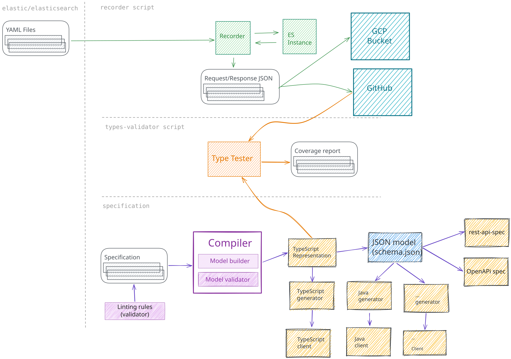

# excalidraw-render

A pure-Rust library and command-line tool that renders
[Excalidraw](https://excalidraw.com) drawings to **SVG, PNG, and vector-first
PDF**, for a whole scene or frame by frame. Fonts and other rendering assets are
bundled: rendering needs no browser, Node.js, network access, or installed
fonts.



<sub>Rendered with `excalidraw-render tests/public-scenes/elasticsearch-spec-overview/scene.excalidraw -o overview.svg`.
Scene: [`overview.excalidraw`](https://github.com/elastic/elasticsearch-specification/blob/3d51338565d6558c96b55dad9142e4c2a500ca38/overview.excalidraw)
from elastic/elasticsearch-specification, © Elastic and contributors,
[Apache-2.0](tests/public-scenes/elasticsearch-spec-overview/LICENSE).</sub>

- Hand-drawn strokes, fills, arrows, text, images, frames, and dark mode, as
  Excalidraw 0.18.1 exports them.
- Every render returns a compatibility report listing the substitutions,
  omissions, and fallbacks it made, instead of failing silently.
- Deterministic output, with resource limits for untrusted input.

**Status:** 0.1.0 is the first release. Output is close to, but not
pixel-identical with, the browser exporter; see the
[known limitations](docs/known-limitations.md).

## Command-line tool

```sh
cargo install --locked excalidraw-render-cli
```

This installs the `excalidraw-render` binary and needs Rust 1.92 or newer.
GitHub releases also carry a prebuilt Linux x86-64 (glibc) archive.

```sh
excalidraw-render drawing.excalidraw -o drawing.svg
excalidraw-render drawing.excalidraw -o drawing.png --scale 2
excalidraw-render drawing.excalidraw -o drawing.pdf
excalidraw-render frames drawing.excalidraw --list
excalidraw-render frames drawing.excalidraw -o frames --format png
```

The output extension selects the format, or use `--format`. Input and output
may be `-` for standard input and output. An existing output is kept unless you
pass `--force`. For large drawings, `--max-dimension 4096` bounds the PNG/PDF
size; it replaces `--scale`, so pass one or the other. Very large drawings can
exceed the PNG size limit; bound them this way or render to SVG or PDF. `frames --list` prints
the frames and the file names an export would write to standard output.
`--report-format json` prints a machine-readable compatibility report.
See `excalidraw-render --help` for every option.

## Rust library

```toml
[dependencies]
excalidraw-render = "0.1"
```

```rust,no_run
use excalidraw_render::{OutputFormat, RenderRequest, Renderer, SceneDocument, Sizing};

fn main() -> Result<(), Box<dyn std::error::Error>> {
    let scene = SceneDocument::parse(&std::fs::read("drawing.excalidraw")?)?;
    let request = RenderRequest::builder(OutputFormat::Png)
        .sizing(Sizing::Scale(2.0))
        .build()?;

    let outcome = Renderer::new().render(&scene, &request)?;
    for diagnostic in outcome.report().diagnostics() {
        eprintln!("{diagnostic}");
    }
    std::fs::write("drawing.png", outcome.artifact().bytes())?;
    Ok(())
}
```

The [library README](crates/excalidraw-render/README.md) covers frame export,
serving untrusted input, the Cargo features (optional PNG, PDF and CJK
support, for example for SVG-only WebAssembly builds), and reproducibility. API
documentation is on [docs.rs](https://docs.rs/excalidraw-render).

## Platforms and compatibility

- The compatibility target is Excalidraw **0.18.1**.
- Linux x86-64 (glibc) is release-qualified. Other native platforms, including
  macOS, build and run but are not release-qualified. Browser WASM is tested
  but experimental, and no JavaScript bindings are shipped.
- Later 0.x releases may intentionally change rendering and diagnostics. Pin
  the version and keep your lockfile when exact output bytes matter.

## Contributing

[CONTRIBUTING.md](CONTRIBUTING.md) explains the test tiers, the comparisons
against Excalidraw's own exports, and how expected output changes are reviewed.
[Development operations](docs/development.md) cover building and running, and
[release.md](release.md) is the release procedure. [CONTEXT.md](CONTEXT.md)
defines the domain vocabulary, and [docs/adr](docs/adr) records design
decisions. Report security vulnerabilities privately as described in
[SECURITY.md](SECURITY.md).

## License

Project code is dual-licensed under [MIT](LICENSE-MIT) or
[Apache-2.0](LICENSE-APACHE). Bundled fonts and adapted third-party code have
their own licenses, collected in the
[license bundle](crates/excalidraw-fonts/LICENSE-BUNDLE.txt). Exports carry the
attribution required by the bundled resources they use.
