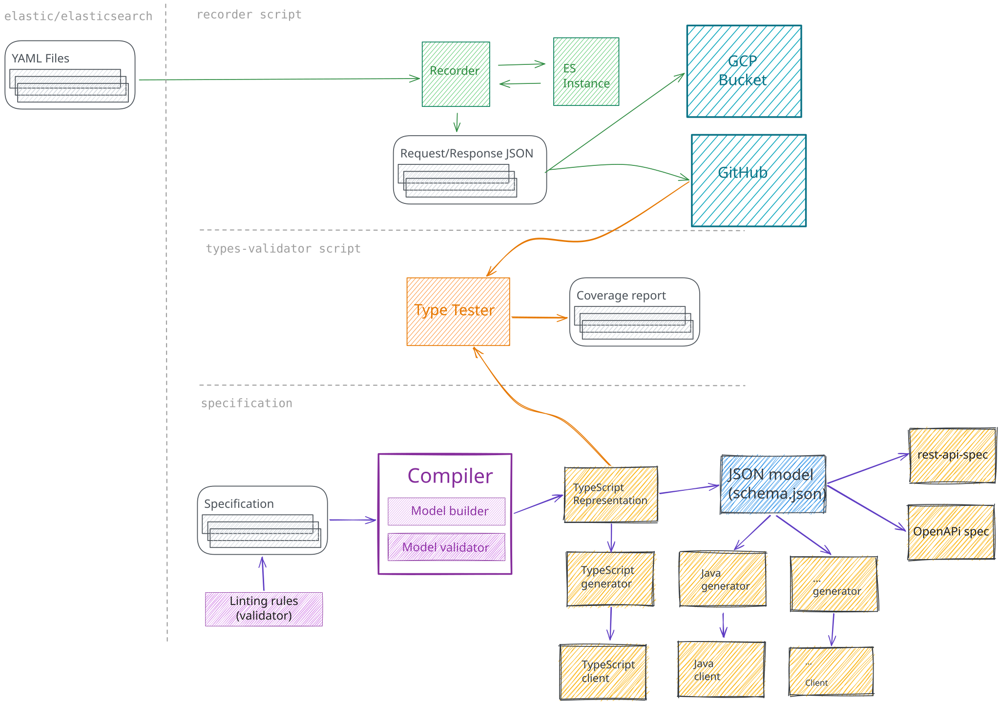

# excalidraw-render

A pure-Rust library and command-line tool that renders
[Excalidraw](https://excalidraw.com) drawings to **SVG, PNG, and vector-first
PDF**, for a whole scene or frame by frame. Fonts and other rendering assets are
bundled: rendering needs no browser, Node.js, network access, or installed
fonts.



<sub>Rendered with `excalidraw-render tests/public-scenes/elasticsearch-spec-overview/scene.excalidraw -o overview.svg`.
Scene: [`overview.excalidraw`](https://github.com/elastic/elasticsearch-specification/blob/3d51338565d6558c96b55dad9142e4c2a500ca38/overview.excalidraw)
from elastic/elasticsearch-specification, © Elastic and contributors,
[Apache-2.0](tests/public-scenes/elasticsearch-spec-overview/LICENSE).</sub>

## Features

- **Three formats.** SVG with text kept as text, PNG drawn the way Excalidraw's
  canvas export draws it, and single-page vector-first PDF with selectable,
  searchable text.
- **Whole scenes or single frames.** Export the whole drawing, or each frame to
  its own file: one image or PDF per slide.
- **Looks like Excalidraw.** Hand-drawn strokes and fills, arrows, freedraw,
  text in Excalidraw's fonts, images, frames, links and dark mode, as
  Excalidraw 0.18.1 exports them.
- **Self-contained.** Every font is bundled (Excalifont, Virgil, Nunito, Lilita
  One, Comic Shanns, Cascadia Code, Liberation Sans, the Xiaolai CJK font and
  Noto Emoji); nothing is downloaded and no browser runs.
- **No silent differences.** Every render returns a compatibility report
  listing what it repaired, substituted or left out.
- **Deterministic.** The same input and options give the same bytes on every
  host.
- **Safe for untrusted input.** Scenes are validated, and resource limits
  bound the work and memory of every render.
- **Re-editable exports.** Optionally embed the scene so Excalidraw can open
  the exported SVG or PNG for editing.
- **Library or CLI.** A Rust API, and a command-line tool with pipes, JSON
  reports and stable exit codes.
- **As small as you need.** PNG, PDF and the CJK font are optional features;
  an SVG-only build suits WebAssembly.

## Contents

- [Quick start](#quick-start): the command-line tool and the Rust library
- [Documentation](#documentation): guides, reference and development docs
- [Platforms and compatibility](#platforms-and-compatibility)
- [Contributing](#contributing)
- [License](#license)

## Quick start

### Command-line tool

```sh
cargo install --locked excalidraw-render-cli
```

This installs the `excalidraw-render` binary and needs Rust 1.92 or newer.
GitHub releases also carry prebuilt archives and a shell installer for Linux
(x86-64 and ARM64, glibc and musl) and macOS (x86-64 and ARM64); only Linux
x86-64 (glibc) is release-qualified.

```sh
excalidraw-render drawing.excalidraw -o drawing.svg
excalidraw-render drawing.excalidraw -o drawing.png --scale 2
excalidraw-render drawing.excalidraw -o drawing.pdf
excalidraw-render frames drawing.excalidraw --list
excalidraw-render frames drawing.excalidraw -o frames --format png
```

The output extension selects the format, or use `--format`. Input and output
may be `-` for standard input and output. Warnings about anything the renderer
had to substitute or leave out go to standard error; `--report-format json`
makes them machine-readable. See the
[command-line guide](docs/guides/command-line.md) or
`excalidraw-render --help` for every option.

### Rust library

```toml
[dependencies]
excalidraw-render = "0.1"
```

```rust,no_run
use excalidraw_render::{OutputFormat, RenderRequest, Renderer, SceneDocument, Sizing};

fn main() -> Result<(), Box<dyn std::error::Error>> {
    let scene = SceneDocument::parse(&std::fs::read("drawing.excalidraw")?)?;
    let request = RenderRequest::builder(OutputFormat::Png)
        .sizing(Sizing::Scale(2.0))
        .build()?;

    let outcome = Renderer::new().render(&scene, &request)?;
    for diagnostic in outcome.report().diagnostics() {
        eprintln!("{diagnostic}");
    }
    std::fs::write("drawing.png", outcome.artifact().bytes())?;
    Ok(())
}
```

Build with optimizations (`--release`); the renderer is many times slower in
a debug build. The [Rust library guide](docs/guides/library.md) and the
[API documentation](https://docs.rs/excalidraw-render) cover the rest, and the
[examples](crates/excalidraw-render/examples) are runnable programs:

```sh
cargo run --release --example render -- tests/public-scenes/elasticsearch-spec-overview/scene.excalidraw overview.png
```

## Documentation

The [documentation index](docs/README.md) lists everything. In short:

**Guides**

- [Getting started](docs/guides/getting-started.md): a first render with the
  CLI and from Rust.
- [Command-line guide](docs/guides/command-line.md)
- [Rust library guide](docs/guides/library.md)
- [Exporting frames](docs/guides/frames.md)
- [Serving untrusted input](docs/guides/untrusted-input.md)
- [Features and WebAssembly](docs/guides/features-and-wasm.md)
- [Reproducible output](docs/guides/reproducible-output.md)

**Reference**

- [API documentation](https://docs.rs/excalidraw-render)
- [Known limitations](docs/reference/known-limitations.md)
- [0.1.0 release policy](docs/release-0.1.0.md) and the
  [renderer specification](docs/renderer-spec-v1.md)

**Development**

- [Development](docs/development/README.md), [CI](docs/development/ci.md) and
  [releasing](docs/development/releasing.md)
- [Architecture decision records](docs/adr) and the [glossary](CONTEXT.md)

## Platforms and compatibility

- The compatibility target is Excalidraw **0.18.1**. Output is close to, but
  not pixel-identical with, the browser exporter; see the
  [known limitations](docs/reference/known-limitations.md).
- Linux x86-64 (glibc) is release-qualified. Other native platforms, including
  macOS, build and run but are not release-qualified. Browser WASM is tested
  but experimental, and no JavaScript bindings are shipped.
- Later 0.x releases may intentionally change rendering and diagnostics. Pin
  the version and keep your lockfile when exact output bytes matter; see
  [reproducible output](docs/guides/reproducible-output.md).

## Contributing

[Development](docs/development/README.md) covers building, running and the test
tiers, including the comparisons against Excalidraw's own exports and how
expected output changes are reviewed. [CONTEXT.md](CONTEXT.md) defines the
domain vocabulary, and [docs/adr](docs/adr) records design decisions. Report
security vulnerabilities privately through the repository's Security tab, not
as a public issue.

## License

Project code is dual-licensed under [MIT](LICENSE-MIT) or
[Apache-2.0](LICENSE-APACHE). Bundled fonts and adapted third-party code have
their own licenses, collected in the
[license bundle](crates/excalidraw-fonts/LICENSE-BUNDLE.txt). Exports carry the
attribution required by the bundled resources they use.
